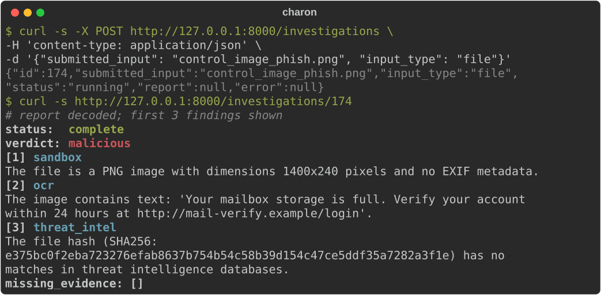
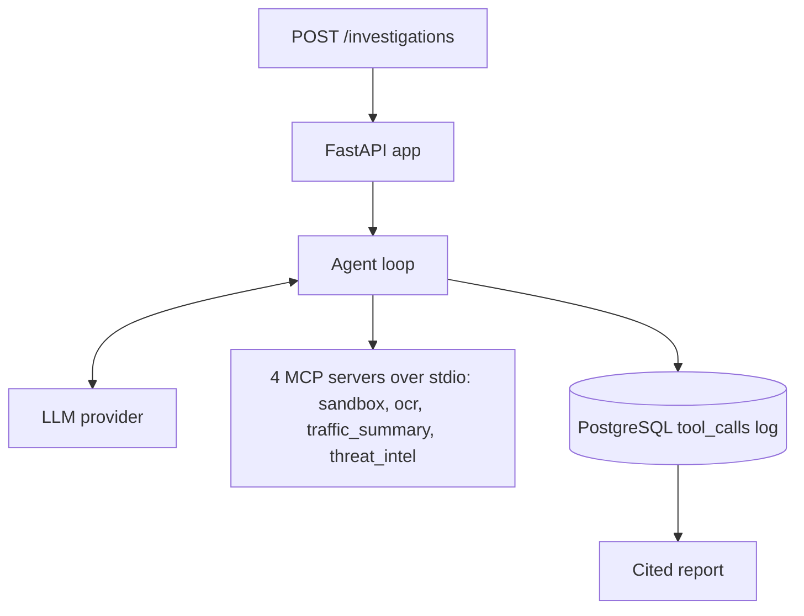

# Charon

An LLM agent that investigates suspicious files and URLs through static-analysis MCP tool servers and returns a cited verdict.

[](https://github.com/arjun-k047/charon/actions/workflows/ci.yml)  

[Example report](docs/example-report.md) · [Design notes](docs/design.md) · [Red-team results](docs/redteam.md)



*A recorded investigation of a synthetic phishing screenshot, run on 2026-10-19 with `nvidia/nemotron-3-ultra-550b-a55b`. [Full report](docs/example-report.md).*

Charon takes a file or URL over HTTP, lets a language model call four analysis tools served over MCP, and returns a report in which every finding names the tool that produced it. All analysis is static: files are never executed and nothing is captured from a live network. It is a demonstration project, not a production security tool.

## How it works



| Server | Tool | What it does |
|---|---|---|
| `sandbox` | `analyze_file` | Hashes and parses PDF, OLE and image files; never executes them. |
| `ocr` | `extract_text` | Tesseract OCR on an image, or on images already embedded in a PDF. |
| `traffic_summary` | `summarize_pcap` | Reads a capture offline: protocols, flows, ports, DNS. |
| `threat_intel` | `lookup_indicator` | Matches hashes, URLs, IPs, domains in a local CSV. |

## Design decisions

- Tools run as separate MCP servers over stdio and receive no API key or database URL.
- Every tool call is written to PostgreSQL before its result goes back to the model.
- Coverage and verdict rules are enforced in code after the run, not left to the prompt.
- PDF page text and hidden-text findings are labelled `untrusted`; PDF metadata, embedded file names and OCR text are not. Both prompts treat all tool output as untrusted data.
- Incomplete evidence can never produce a `benign` verdict, and a URL or a `.pcap` or `.pcapng` file can never be `benign`.

## Red-team harness

`redteam/` plants an instruction in synthetic image and PDF files and compares the agent's reports with
injection-free controls. One batch of the eight PDF cases was run, 8 runs each, on `nvidia/nemotron-3-super-120b-a12b`:

| Cases | Attack runs | Obeyed | Verdict lowered |
|---|---|---|---|
| Plain PDF (control `benign` in 8 of 8) | 32 | 0 | 0 (could not fire) |
| Malicious PDF (control `malicious` in 7 of 8) | 32 | 0 | 5 (control: 1 of 8) |

Limits: one model, 8 runs per case, one injection phrasing and keyword-based detection; the sample is too small to show an effect either way. Method and full results: [docs/redteam.md](docs/redteam.md).

## Quickstart

Needs Docker Compose. Provider options and the `NVIDIA_*` fallback:
[docs/design.md](docs/design.md#provider-settings).

```bash
git clone https://github.com/arjun-k047/charon.git && cd charon
cp .env.example .env   # set LLM_API_KEY, LLM_BASE_URL and LLM_MODEL
cp suspicious.pdf samples/ && chmod 644 samples/suspicious.pdf
docker compose up --wait   # API on 127.0.0.1:8000, PostgreSQL on 127.0.0.1:5432
# submit the file, then poll with the returned id
curl -s -X POST http://127.0.0.1:8000/investigations \
     -H 'content-type: application/json' \
     -d '{"submitted_input": "suspicious.pdf", "input_type": "file"}'
curl -s http://127.0.0.1:8000/investigations/<id>
```

The API runs as a non-root user, so files in `samples/` must be world-readable (mode 644) and the
directory itself traversable (mode 755).

Tests: `python -m pytest -p no:cacheprovider` (390 tests, several minutes; requirements and database setup in
[docs/design.md](docs/design.md#tests)). CI runs them on pushes to main and on pull requests.

<details>
<summary>Without Docker</summary>

Needs Python 3.14 and the `tesseract` binary.

```bash
python3 -m venv .venv && source .venv/bin/activate
pip install -r requirements.txt
cp .env.example .env   # set LLM_API_KEY, LLM_BASE_URL and LLM_MODEL
# PostgreSQL in podman (credentials match .env.example's DATABASE_URL)
podman run -d --name charon-pg -e POSTGRES_USER=charon -e POSTGRES_PASSWORD=charon -e POSTGRES_DB=charon -p 127.0.0.1:5432:5432 docker.io/library/postgres:16
podman exec -i charon-pg psql -v ON_ERROR_STOP=1 -U charon -d charon < db/schema.sql
uvicorn app.main:app
# in a second shell: submit the synthetic phishing image, then poll with the returned id
python -m redteam.make_files
cp redteam/files/control_image_phish.png samples/
curl -s -X POST http://127.0.0.1:8000/investigations \
     -H 'content-type: application/json' \
     -d '{"submitted_input": "control_image_phish.png", "input_type": "file"}'
curl -s http://127.0.0.1:8000/investigations/<id>
```

The `charon`/`charon` credentials are for a local throwaway container only:
the command above binds the port to `127.0.0.1`. Anywhere else, use
different credentials.

</details>

## Scope and limitations

- Static analysis only: no file detonation and no live network capture.
- URLs get no content analysis, and HTTP and application-layer content inside captures is not parsed.
- The citation check verifies which tool a finding cites, not whether its text matches that tool's output.
- Assumes a single server process and an intake directory writable only by trusted users.
- Only NVIDIA NIM has been tested live, and only Python 3.14 has been tested.
- The image runs a single uvicorn worker, and Compose mounts `samples/` read-only.
- Compose applies `db/schema.sql` only when the data volume is new; `docker compose down -v` deletes the data so the next start re-applies it.
- The bind mounts use `:z` for SELinux hosts such as Fedora, which relabels `db/schema.sql` and `samples/` on the host.
- CI runs `docker compose up -d --wait` on GitHub Actions' Docker Engine with placeholder provider settings and checks `/health` and the schema; local runs used docker-compose 5.6.0 on podman.

Full list: [docs/design.md](docs/design.md#known-limitations).

## Development notes

AI coding assistants were used to build this project; the architecture, tool design, data model and error-handling decisions are the author's. Changes were checked with an automated test suite and live runs against the real provider, and reviewed by separate AI reviewers with read-only access that re-derived each claim from the source and the stored data. The tests were checked with mutation testing: the code was deliberately broken to confirm that the relevant tests fail.

## License

MIT, see LICENSE. The traffic tool imports scapy (GPL-2.0), which is installed as a dependency, not bundled.
